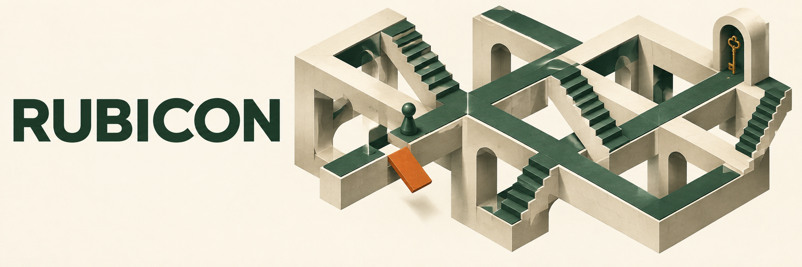

<p align="center">
  
</p>

<h1 align="center">RUBICON</h1>
<p align="center"><strong>Do Language Models Know When They've Crossed the Point of No Return?</strong></p>
<p align="center">
  <a href="https://rubicon-eval.github.io/">Project website</a> ·
  <a href="https://huggingface.co/datasets/ajirs/rubicon">Dataset on Hugging Face</a> ·
  <a href="#quick-start">Quick start</a>
</p>

RUBICON evaluates whether language models recognize when their own earlier actions have made a task impossible to complete. Three visual puzzle environments turn irreversible choices into precisely defined state transitions, with symbolic oracles providing ground truth.

**This repository is the public code release.** It includes puzzle engines, generators, renderers, evaluation runners, scoring, and a local inspection app. The evaluation data and a viewer-ready version are hosted on [Hugging Face](https://huggingface.co/datasets/ajirs/rubicon).

## The benchmark at a glance

| Domain | Irreversible constraint | What can go wrong? |
|---|---|---|
| **Mosaic Grid** | Leaving a tile paints it permanently | A painted corridor cuts off a necessary route |
| **Chain Vault** | Opening a door consumes matching keys | Spending a scarce key makes the exit unreachable |
| **Tide Grid** | Every action consumes time and oxygen while tiles flood cyclically | A timing decision leaves too little oxygen to finish |

| Task | Question |
|---|---|
| **RQ1 · Simulation fidelity** | Where will the agent be after the given actions? |
| **RQ2 · Foresight** | Is the current state still solvable? |
| **RQ3 · Causal attribution** | Which action first made the task unsolvable? |

The packaged release contains **2,100 evaluation records**, **600 images**, **3 domains**, and **7 task/ablation variants per domain**. Each variant has 100 records. Variants reuse underlying puzzles and images; 2,100 is not a count of distinct puzzles. There is no training split in this release.

## Quick start

Requires **Python 3.12+**. Run commands from the repository root.

```bash
git clone https://github.com/rubicon-eval/Rubicon.git
cd Rubicon
uv sync --locked
uv run python scripts/download_dataset.py
uv run python scripts/validate_dataset.py
```

Expected validation output: `2100` records, `600` images, `3` domains, `7` task variants. The download is checked against the file hashes in `dataset-manifest.json`. An existing nonempty dataset directory is not overwritten.

Without `uv`:

```bash
python3 -m venv .venv
source .venv/bin/activate  # Windows: .venv\Scripts\activate
python -m pip install -e .
python scripts/download_dataset.py
python scripts/validate_dataset.py
```

For an offline machine, download [`rubicon-original.zip`](https://huggingface.co/datasets/ajirs/rubicon/resolve/main/rubicon-original.zip) and use `python scripts/download_dataset.py --archive /path/to/rubicon-original.zip`.

## Run an evaluation

The main runner supports **OpenAI-compatible multimodal chat endpoints**. Choose an image-capable model exposed by your provider. The endpoint must support streaming chat completions.

```bash
cp .env.example .env
# Edit .env: set OPENAI_API_KEY and OPENAI_BASE_URL.
```

First validate a run without making API requests:

```bash
uv run python scripts/model_runs/run_openai_compatible.py \
  --dataset-file dataset/dataset_mosaic_grid/rq1_main.json \
  --model YOUR_MODEL_ID \
  --output responses/mosaic_grid/rq1_main__release.jsonl \
  --limit 3 --dry-run
```

Then remove `--dry-run` to evaluate those examples. Remove `--limit 3` for the complete task. Actual inference uses your provider account and may incur charges.

Useful options: `--workers`, `--max-tokens`, `--temperature`, `--timeout-seconds`, `--fail-fast`. Successful `eval_id`s in an output file are skipped when resuming. **Use a new output path or `--overwrite` when changing prompts, models, or generation settings.** Cache keys distinguish model, endpoint, prompt, image, and generation settings. Failed requests cause a nonzero exit; successful records remain available for resuming.

To evaluate several models, use `scripts/model_runs/run_openai_compatible_models.py` with repeatable `--model` arguments. The `.sh` wrappers are available on macOS/Linux after creating the repository's `.venv`.

## Score the responses

For the RQ1 example above:

```bash
uv run python scripts/judge.py \
  --puzzle mosaic_grid --rq rq1_main --model release \
  --resp-dir responses/mosaic_grid \
  --response-file responses/mosaic_grid/rq1_main__release.jsonl
```

The explicit `--response-file` avoids ambiguous filename matching. Results are written under `results/<puzzle>/<model>/`.

- **RQ1:** checks the `POSITION: (row, col)` answer.
- **RQ2 ablations:** check `SOLVABLE: YES` or `SOLVABLE: NO`.
- **RQ3:** checks `FATAL STEP: n` against the **one-indexed** fatal step.
- **RQ2 hard:** uses an external LLM judge. Set `AZURE_OPENAI_API_KEY` and `AZURE_OPENAI_BASE_URL`; optionally set `RUBICON_JUDGE_MODEL` (default `gpt-4.1-mini`).
- `--llm-fallback` enables external answer extraction for parsing failures and also requires judge credentials.

See [evaluation details](docs/EVALUATION.md) for task filenames, output conventions, optional Google runners, and reproducibility notes.

## Use the dataset with Hugging Face

```bash
uv sync --locked --extra data
```

```python
import json
from datasets import load_dataset

examples = load_dataset("ajirs/rubicon", "mosaic_grid", split="test")
example = examples[0]
image = example["image"]             # decoded PIL image
prompt = example["prompt"]
ground_truth = json.loads(example["ground_truth_json"])
```

Configurations: `all`, `mosaic_grid`, `chain_vault`, `tide_grid`. Each has a `test` split; use the `task` column to select a task variant. Ground truth and metadata are JSON strings because their fields differ across domains and tasks. The original JSON structure is preserved in the ZIP download.

## Generate and inspect puzzles

```bash
uv run python -m puzzles.mosaic_grid --help
uv run python -m puzzles.chain_vault --help
uv run python -m puzzles.tide_grid --help
```

Each domain provides `demo`, `generate`, `build`, and `full` commands. Use the subcommand's `--help` for generation parameters. Regeneration can be computationally intensive and is not a substitute for the pinned release when reproducing its evaluations.

Inspect a downloaded domain locally:

```bash
uv run python -c "from verify.app import run_verify; run_verify('dataset/dataset_mosaic_grid', debug=False)"
```

Open `http://localhost:5050/dashboard`. This app supports local validation annotations; it is not a hosted public service.

## Development

```bash
uv sync --locked --all-extras --dev
uv run --no-sync pytest -q
uv build
```

Optional extras: `google` (Google GenAI and Redis client), `analysis` (plot label adjustment), `editor` (Gradio prompt editor), `data` (Hugging Face loading/export).

```text
puzzles/                 Engines, symbolic oracles, generators and renderers
scripts/model_runs/      Main OpenAI-compatible runners
scripts/                 Download, validation, evaluation and analysis tools
verify/                  Local Flask inspection app
tests/                   Offline release regression tests
docs/                    Evaluation and reproducibility guide
dataset-manifest.json    SHA-256 hashes of the original dataset files
```

<sub>The impossible-puzzle banner is conceptual AI-generated artwork; actual benchmark examples are shown on the project website and dataset viewer.</sub>
